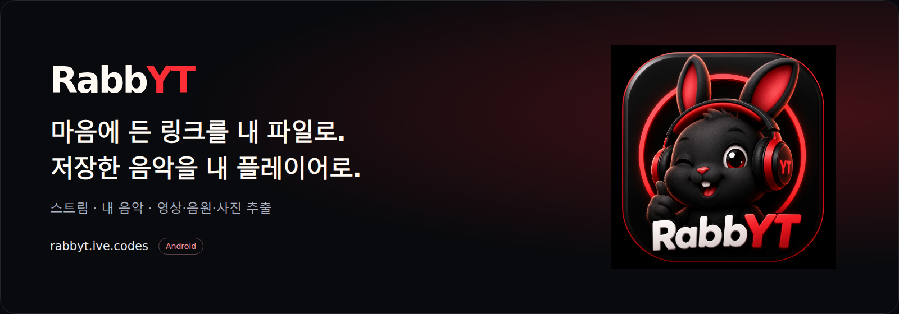
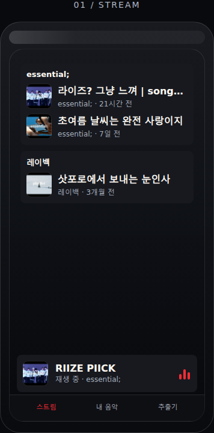
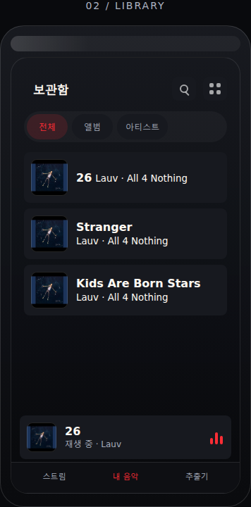
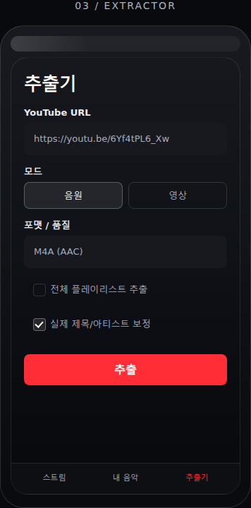

<p align="center">
  <a href="https://rabbyt.ive.codes/">
    
  </a>
</p>

<p align="center">
  <b>듣고, 저장하고, 다시 찾는 경험을 하나로.</b><br>
  YouTube 플레이리스트를 듣고, 영상·음원·사진을 저장하고,<br>
  기기에 모아 둔 음악을 정리해 재생하는 Android 앱입니다.
</p>

<p align="center">
  <a href="https://rabbyt.ive.codes/"><b>웹사이트</b></a> ·
  <a href="https://rabbyt.ive.codes/api/latest-apk"><b>APK 다운로드</b></a> ·
  <a href="https://github.com/hojin-v/RabbYT-download/releases/latest">업데이트 소식</a> ·
  <a href="https://rabbyt.ive.codes/#guide">사용 가이드</a>
</p>

<p align="center">
  
  
  <a href="https://github.com/hojin-v/RabbYT-download/releases/latest"></a>
</p>

<br>

## 듣는 순간부터, 내 파일로 남기기까지

좋아하는 플레이리스트를 듣다가 음원으로 남기고 싶을 때, 저장한 음악을 다시 찾아 듣고 싶을 때. RabbYT는 **온라인 스트림 → 파일 저장 → 내 음악 재생**이 한 앱 안에서 이어지도록 만들었습니다.

<table>
  <tr>
    <th width="33%" align="center">스트림</th>
    <th width="33%" align="center">내 음악</th>
    <th width="33%" align="center">추출기</th>
  </tr>
  <tr>
    <td align="center"></td>
    <td align="center"></td>
    <td align="center"></td>
  </tr>
</table>

<p align="center"><sub>랜딩페이지의 화면 예시입니다. 버전과 기기에 따라 실제 앱 화면은 달라질 수 있습니다.</sub></p>

- **스트림** — 추천 채널의 YouTube 플레이리스트형 영상을 둘러보고 바로 재생합니다.
- **내 음악** — 기기에 저장된 음악을 앨범·아티스트·폴더·재생목록으로 찾고 듣습니다.
- **추출기** — 링크를 공유하거나 붙여넣고, 원하는 형식의 영상·음원·사진으로 저장합니다.

## 링크를 가져오면, 저장할 옵션을 고를 수 있어요

1. **링크 가져오기** — 다른 앱의 공유 메뉴에서 RabbYT를 선택하거나 추출기에 주소를 붙여넣습니다. YouTube와 기타 사이트 링크를 자동으로 구분합니다.
2. **저장 방식 선택** — 음원·영상·사진 중 원하는 종류와 포맷을 고릅니다. 기타 사이트는 `Other URL`에서 링크를 분석해 실제로 제공되는 옵션을 확인합니다.
3. **추출 시작** — 저장 폴더를 확인하고 추출합니다. 다음 링크도 추가하면 대기열 순서대로 이어서 처리합니다.

| 종류 | 고를 수 있는 옵션 |
| --- | --- |
| **음원** | YouTube는 M4A(AAC) 권장, Opus 원본, MP3. 기타 사이트는 제공되는 원본과 호환 형식을 기준으로 표시합니다. |
| **영상** | YouTube는 원본 최고품질 MKV 또는 최대 1080p·720p·480p MP4. 기타 사이트는 분석된 해상도·형식을 선택합니다. 여러 음성 언어를 함께 넣거나 음성을 제거할 수 있습니다. |
| **사진** | Instagram 사진을 전체 또는 여러 장 선택해 저장합니다. 원본 확장자를 확인하고 원본·JPG·PNG·WebP 중에서 고릅니다. |
| **자막** | 한국어·영어 등록 자막을 우선하고, 없으면 사이트가 제공하는 자동 생성·번역 자막을 시도합니다. 실제 포함 여부와 실패 이유를 결과에서 확인합니다. |

기타 사이트에서는 원본이 기본 앱 호환 조건에 맞으면 **원본/권장**으로 표시합니다. 변환이 필요한 경우 원본과 권장을 나누고 권장을 기본으로 선택합니다. 실제 품질과 형식은 원본 사이트가 제공하는 미디어에 따라 달라집니다.

## 저장한 뒤에도, 찾기 쉽게

- **작업 큐** — 작업 제목과 원본 링크, 진행 상태를 확인합니다. 대기 작업을 취소하거나 실패한 작업을 다시 대기열에 넣을 수 있습니다.
- **추출 기록** — 날짜별로 모인 기록에서 제목·채널·링크·포맷을 검색합니다. 사이트·종류·기간 필터와 정렬, 링크 복사, 선택 삭제를 제공합니다.
- **폴더 정리** — YouTube 음원·영상은 `RabbYT/Music`, `RabbYT/Video`로, 기타 사이트는 플랫폼·계정·종류·추출일별로 저장합니다. 저장 폴더도 직접 지정할 수 있습니다.
- **음악 플레이어** — 앨범·아티스트·재생목록으로 음악을 관리하고, 셔플·반복·슬립 타이머를 사용합니다. 백그라운드 재생과 알림·잠금화면 조작도 지원합니다.
- **로그인 관리** — 열쇠 아이콘에서 사이트별 로그인 정보를 관리합니다. 로그인 정보를 저장하고, 아이디와 비밀번호는 저장하지 않습니다.

기타 사이트의 기본 저장 구조는 다음과 같습니다. 실제로 저장할 때 필요한 폴더만 만듭니다.

```text
Download/RabbYT/
├── Music/
├── Video/
└── Instagram/
    └── 계정명/
        └── image/2026-10-18/
            └── 261018_152939 - 계정명 - 01.jpg
```

## 설치와 업데이트

**Android 8.0 이상 · ARM64 기기**를 지원합니다.

1. [APK 다운로드](https://rabbyt.ive.codes/api/latest-apk)를 눌러 최신 정식 버전을 받습니다.
2. 받은 APK를 열고 Android 설치 화면의 안내에 따라 설치합니다.
3. 내 음악을 사용하려면 음악 접근 권한을 허용하고, 추출기에서 저장 폴더를 확인합니다.

기존 앱을 업데이트할 때는 앱을 삭제하지 않고 새 APK를 설치하면 됩니다. APK와 같은 APK가 들어 있는 ZIP은 [정식 릴리즈](https://github.com/hojin-v/RabbYT-download/releases)에서 제공합니다.

<details>
<summary><b>지원 사이트와 로그인</b></summary>

YouTube·YouTube Music과 내장 yt-dlp가 지원하는 기타 사이트의 미디어를 처리합니다. Instagram·Threads·X 등도 사이트가 제공하는 파일과 현재 접근 가능한 콘텐츠를 기준으로 분석합니다. 모든 사이트의 모든 게시물이 지원되는 것은 아니며, 사이트 변경이나 접근 제한에 따라 달라집니다. 사진 저장은 Instagram 게시물 분석을 확장한 RabbYT 자체 기능입니다.

로그인이 필요한 콘텐츠는 열쇠 아이콘에서 해당 사이트에 로그인한 뒤 다시 분석합니다. 저장한 로그인 정보는 기기에서 암호화해 보관하며, 사이트에서 로그아웃되거나 본인 확인을 요구하면 다시 로그인해야 합니다. 삭제·만료된 게시물이나 계정에 열람 권한이 없는 콘텐츠는 로그인해도 받을 수 없습니다.

</details>

<details>
<summary><b>원본 파일과 메타데이터</b></summary>

`원본`은 사이트가 제공하는 미디어를 뜻합니다. 업로드 전의 촬영 파일이나 효과가 적용되기 전의 파일을 뜻하지는 않습니다.

게시물에서 제공하는 게시 시각·위치와 파일에 남아 있는 메타데이터를 가능한 범위에서 보존하고, 추출 시각은 별도로 기록합니다. 사이트가 제거했거나 제공하지 않는 촬영 정보·좌표는 복원하지 않습니다. 추출 기록의 날짜 구분은 추출한 시각을 기준으로 합니다.

</details>

<details>
<summary><b>정식과 베타, 엔진 업데이트</b></summary>

공개 다운로드 페이지와 [RabbYT-download 릴리즈](https://github.com/hojin-v/RabbYT-download/releases)는 정식 버전만 제공합니다. 베타는 개발 저장소에서 별도로 운영하며, 비공개 운영 시 접근 권한이 있는 GitHub 계정이 필요합니다. 정식 앱과 RabbYT Beta는 별도 앱으로 설치됩니다.

정식 2.2.1부터 영상의 썸네일·첫 장면을 사진으로 저장할 수 있으며, Instagram 스토리의 계정명 저장도 개선했습니다. 각 버전의 변경 내용은 릴리즈의 배포 설명에서 확인할 수 있습니다.

추출 엔진은 최신 정식 버전을 확인하고 파일 검사와 기본 호환성 검증을 거쳐 준비합니다. 새 엔진은 다음 앱 실행에 적용하며, 준비나 로딩에 실패하면 기존 엔진을 사용합니다.

</details>

---

저장 권한이 있는 콘텐츠에 사용하세요. 제공 사이트와 업로더의 설정에 따라 추출 가능한 미디어·품질·자막이 달라집니다. RabbYT는 YouTube·Google·Instagram 등 제공 사이트와 제휴하지 않습니다.

<details>
<summary><b>이 저장소와 다운로드 페이지 운영</b></summary>

이 저장소는 RabbYT의 공개 다운로드 페이지와 정식 APK·ZIP을 제공합니다. APK 파일은 Git 이력에 넣지 않고 GitHub Releases에 배포합니다. 앱 소스 저장소에서 빌드한 정식 파일·제목·배포 설명을 동일하게 게시하고 파일 크기·SHA-256을 검증합니다. 공개 태그는 이 페이지의 커밋을 가리키며 앱 소스를 포함하지 않습니다.

다운로드 버튼은 `/api/latest-apk`를 사용합니다. 이 함수와 브라우저의 버전 조회는 이 저장소의 GitHub Releases를 우선 확인하고, 정식 버전 형식의 태그와 `RabbYT-Android-vX.Y.Z.apk`만 선택합니다. 초안과 베타는 제외합니다. 모든 조회가 실패하면 공개 정식 릴리즈 목록으로 안내합니다.

이전 중에는 개발 저장소의 공개 릴리즈 주소도 임시 대체 주소로 확인합니다. 공개 정식이 있으면 개발 저장소 조회가 필요하지 않아 소스 비공개 전환 후에도 동작합니다.

정적 파일은 `index.html`, `styles.css`, `script.js`, `assets/`, 최신 APK 연결은 `api/latest-apk.js`, 배포 설정은 `vercel.json`에 있습니다. Vercel에 연결하며 운영 주소는 [rabbyt.ive.codes](https://rabbyt.ive.codes/)입니다.

```bash
python3 -m http.server 8000
node --test tests/releases.test.js
```

로컬 정적 미리보기에는 Vercel 함수가 없으므로 직접 APK 다운로드는 배포 주소에서 확인합니다. 브라우저에서 `http://localhost:8000`을 열면 페이지를 미리 볼 수 있습니다.

README 배너는 기존 RabbYT 로고를, 세 화면 예시는 랜딩페이지의 HTML·CSS 목업을 사용합니다. 다음 명령으로 이미지를 다시 생성합니다. 앱의 실제 화면 캡처와 구분해 안내합니다.

```bash
python -m pip install playwright
playwright install chromium
python scripts/render_readme.py
```

기존 Chromium을 사용할 때는 `--browser /path/to/chromium`을 지정합니다.

</details>
